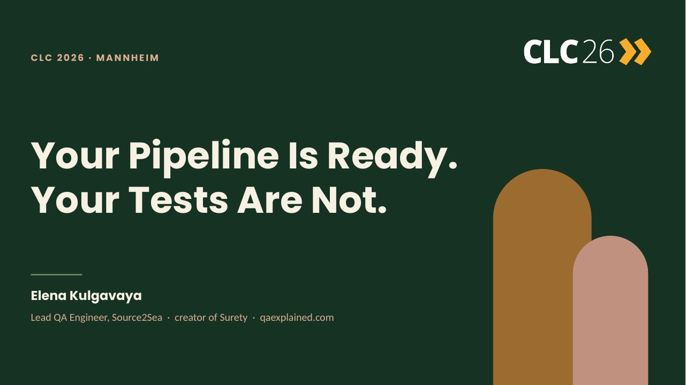
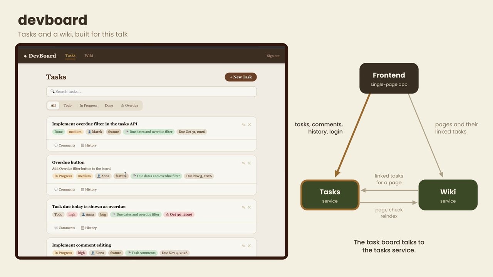
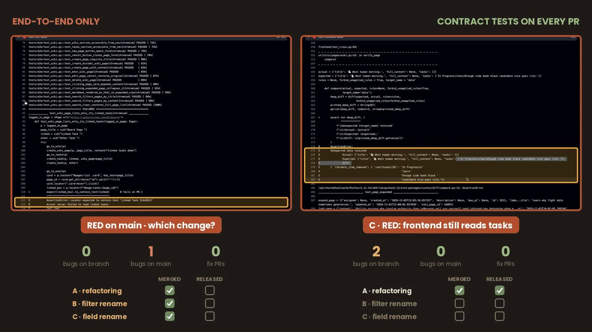

# Your Pipeline Is Ready. Your Tests Are Not.

**Elena Kulgavaya** · CLC 2026, Mannheim · 12 November 2026

Many teams that say they do continuous delivery really have automated deployment: the pipeline ships the code, then the release waits for someone to sign it off. This talk explains why automating the old test flow doesn't fix that, which tests can live inside a fully automated pipeline, and how contract tests let you test integrations **before merge**. devboard, the app in this repository, is the demo.

## Materials

| | |
|---|---|
| Slides (PDF) | [clc-2026-your-pipeline-is-ready.pdf](slides/clc-2026-your-pipeline-is-ready.pdf) |
| Slides (PowerPoint) | [clc-2026-your-pipeline-is-ready.pptx](slides/clc-2026-your-pipeline-is-ready.pptx) |
| Video: the devboard app (≈1 min) | https://youtu.be/7SOhgkAlFA0 |
| Video: the demo, end-to-end vs. contract tests (≈7 min) | https://youtu.be/c41kOBuAqtA |

## What the talk covers

1. **Automated deployment is not continuous delivery.** Deployment ships the code; delivery hands it over to users. What usually blocks the last step is a manual test gate on a shared environment.
2. **How releases really happen.** One change at a time means a queue; batching changes means that when a bug shows up, nobody knows which change caused it. As features grow, regression grows, release cycles stretch out, and you end up with code freezes.
3. **Automating the old flow keeps the old problems.** Tests still need a deployment, shared environments and shared data make them flaky, failures have no clear owner, and maintenance grows. Better reports and dashboards treat the symptoms, not the root cause.
4. **What pipeline tests must be:** stable, precise, isolated and fast. Unit tests meet all four rules but don't cover integration. End-to-end tests cover integration but break every rule.
5. **Contract tests close the gap.** Consumer and provider share a contract; each side tests against it with the other side mocked, so integration is covered without a deployed system. Contracts don't have to be APIs: database records, events, message queues, browser storage and system state work too.
6. **Move testing before merge.** When tests run on the branch, bugs stay on the branch, and everything after merge (deploy, release) can be fully automated.

## The demo

Three ordinary pull requests, made by three engineers, go through two setups: **end-to-end tests after merge** (left) and **contract tests on every pull request** (right).

- **A:** Tasks service, a small, safe refactoring.
- **B:** Tasks service renames a query filter, `wiki_page_id` → `page_id`. This breaks the wiki service.
- **C:** Wiki service renames a response field, `tasks` → `items`. This breaks the frontend.

| | End-to-end after merge | Contract tests on every PR |
|---|---|---|
| Bugs that reached main | 2 | 0 |
| Fix pull requests | 2 | 0 (fixed on the same branch) |
| Safe change A released | after ≈20 min, stuck behind the bugs | ≈3 min after the work started |
| All three released | ≈20 min | ≈15 min |

Same work, same fixes. The difference is where the bugs were caught.

## Where to find the demo in this repo

- [`tests/e2e/test_cross.py`](../../../tests/e2e/test_cross.py) — end-to-end test `test_wiki_page_lists_only_its_linked_tasks`
- [`tests/contracts/wiki/test_get_page_tasks.py`](../../../tests/contracts/wiki/test_get_page_tasks.py) — contract test: wiki ↔ tasks
- [`tests/contracts/frontend/test_page_expand.py`](../../../tests/contracts/frontend/test_page_expand.py) — contract test: frontend ↔ wiki
- [`tests/contracts/utils/api/wiki.py`](../../../tests/contracts/utils/api/wiki.py) — shared Surety contract: `GetPageTasks`
- [`tests/contracts/utils/api/tasks.py`](../../../tests/contracts/utils/api/tasks.py) — shared Surety contracts: `GetTasks`, `GetTasksParams.WikiPageId`
- [`.github/workflows/e2e.yml`](../../../.github/workflows/e2e.yml) — CI: end-to-end tests (the "after merge" setup)
- [`.github/workflows/wiki-tests.yml`](../../../.github/workflows/wiki-tests.yml) — CI: wiki contract tests on every PR
- [`.github/workflows/tasks-tests.yml`](../../../.github/workflows/tasks-tests.yml) — CI: tasks contract tests on every PR
- [`.github/workflows/frontend-tests.yml`](../../../.github/workflows/frontend-tests.yml) — CI: frontend contract tests on every PR

## Takeaways

1. **Earlier tests don't slow you down.** They are what unblocks delivery. Automating the old flow only postpones the moment you realise you have to change it.
2. **Hold every pipeline test to the four rules.** A test that is unstable, slow, or tied to environments or shared data is a no-go; it will be ignored in no time.
3. **Test integrations before deployment.** That is what lets you go fully automated, and contract testing makes it possible.

> Automated deployment is not continuous delivery. Your tests make the difference.

## Links

- Blog: [qaexplained.com](https://qaexplained.com)
- Surety, the contract testing framework used in the demo: [surety.readthedocs.io](https://surety.readthedocs.io)
- Conference: [CLC 2026](https://clc-conference.eu/2026/)
